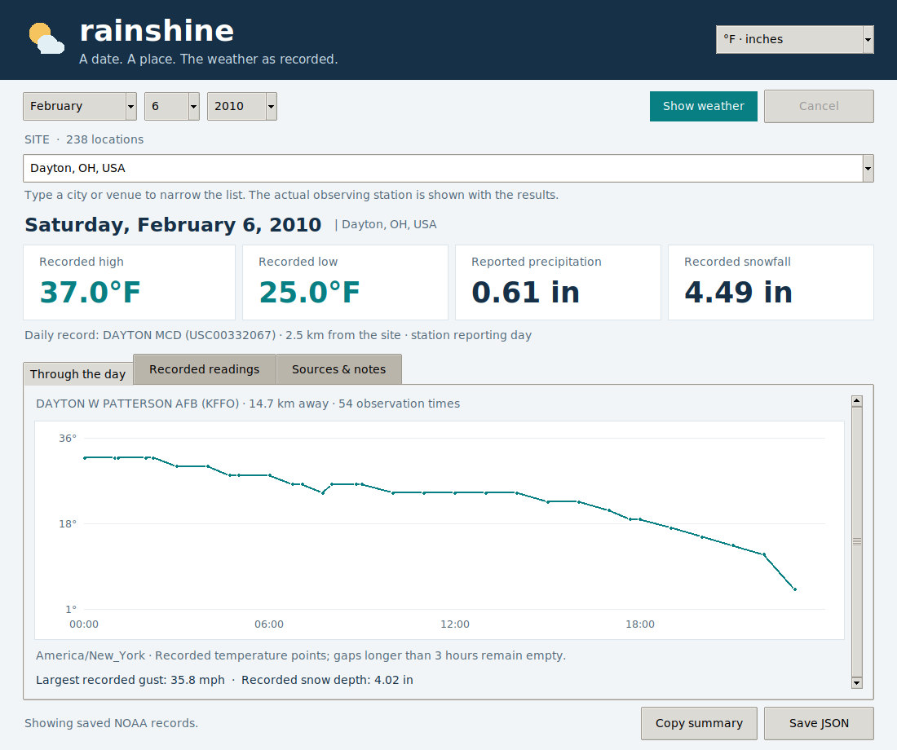

# Rainshine

A small Python desktop app for **the weather as recorded**. Choose a date and
one of the 238 documented locations to see NOAA station records, a temperature
plot, and the actual observations behind the display.



## Install and run

Python **3.11 or newer** is required. Tkinter normally ships with the Windows
and macOS installers from python.org. On Debian/Ubuntu, install `python3-tk`.

From a checkout of this repository, on Windows with Python 3.14:

```powershell
py -3.14 -m pip install -e .
py -3.14 -m rainshine
```

On macOS or Linux:

```sh
python3 -m venv .venv
.venv/bin/python -m pip install -e .
.venv/bin/python -m rainshine
```

After installation, `rainshine` also opens the GUI. `rainshine-gui` is available
as a Windows GUI entry point. No API key or account is required.

## Use

1. Choose a month, day, and year. The selectable range is **January 1, 1989
   through December 31, 2032**. The day list adjusts for each month and leap year.
2. Choose a site. Type part of a city or venue name to narrow the dropdown.
3. Select **Show weather**. Rainshine keeps the window responsive while it
   downloads the required records. The first lookup can take longer because
   NOAA distributes subdaily data as station-year files.
4. Switch between Fahrenheit/inches and Celsius/millimeters. **Recorded
   readings** shows actual report times; **Sources & notes** includes station
   identifiers, distances, download times, flags, gaps, and source URLs.
5. Use **Copy summary** or **Save JSON** to keep a result and its provenance.

The version is visible in the title bar. Downloads are cached in
the user's local cache directory, outside the installed package. Cancellation
stops the active lookup without freezing the window. Previously downloaded
observations can be displayed offline; an expired saved copy is labelled if
NOAA cannot be refreshed.

## What the display means

- **Daily cards** use a GHCN-daily station record. The closest documented
  candidate with high, low, and precipitation is preferred; when no candidate
  has all three, the most complete available record is shown. Station identity
  and distance remain visible. Missing values stay empty; trace precipitation
  remains a trace. NOAA's presumed-zero precipitation and failed-quality values
  are excluded.
- **Through the day** uses GHCN-hourly observations from the nearest documented
  candidate with records on the requested local calendar day. Reported UTC
  timestamps are converted using the location's historical timezone rules.
  A local day can therefore contain 23 or 25 hours. Points are recorded
  temperatures; gaps longer than three hours remain disconnected.
- Daily station reporting periods can end at an observation time instead of
  midnight. A daily record and a local calendar-day plot can cover different
  periods and may come from different nearby stations. Both sources are shown.
- Numeric source-specific quality codes are decoded separately. For example,
  GHCN-hourly quality code `5` is acceptable for some sources and means removed
  for others. Explicit estimated subdaily values are excluded.
- Sky descriptions appear only when an explicit recognized ICAO cloud label
  is present. Rainshine does not infer clear skies from missing cloud data.
- Future dates stay selectable and return **No recorded weather yet**. Other
  unavailable dates return an honest missing-record message. Rainshine does
  not substitute forecasts, climate normals, or reanalysis estimates.

## Locations and source data

The packaged catalog is derived from the previously researched Telegraphy
location/station lookup. It includes all 238 settings, candidate NOAA stations,
coordinates, timezones, and inventory intervals. Venue coordinates and
distances are approximate. This is a documented candidate set, rather than an
exhaustive search of every sensor. Sites remain selectable for every supported
date, regardless of the venue's opening year.

NOAA data are retrieved when requested, not bundled with the application.
Inventories are hints; the actual day must contain usable observations. Dataset
availability and station histories vary. For details and attribution, see
[DATA_SOURCES.md](DATA_SOURCES.md).

## Headless access

```sh
rainshine --list-sites
rainshine --date 2010-02-06 --site "Dayton, OH, USA"
rainshine --version
```

The date/site command prints JSON in native metric units with source URLs and
flags. It uses the same service as the GUI. A Python caller can use it directly:

```python
from datetime import date
from rainshine.service import WeatherService

report = WeatherService().fetch("Dayton, OH, USA", date(2010, 2, 6))
data = report.to_dict()
```

## Development

The application uses the Python standard library. Windows installs the pinned
`tzdata` dependency for IANA timezones. Build requirements are also pinned.

```sh
python -m pip install -e .
python -m unittest discover -s tests -v
```

GUI tests automatically skip without a display. Under a Linux virtual display,
run the same command with `DISPLAY` set. The test suite does not require a NOAA
connection; parsers, date boundaries, quality codes, fallback selection, future
dates, cache recovery, exports, and GUI interactions use controlled fixtures.

Licensed under the existing [MIT license](LICENSE).
